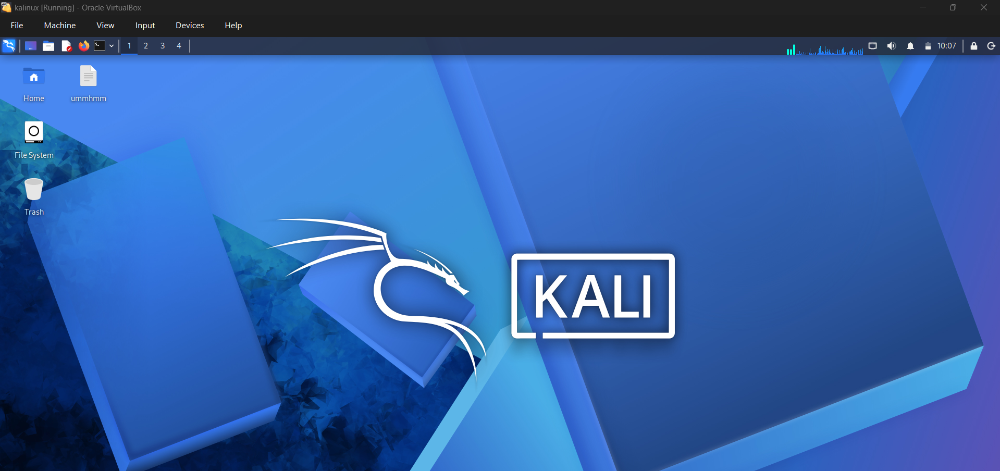
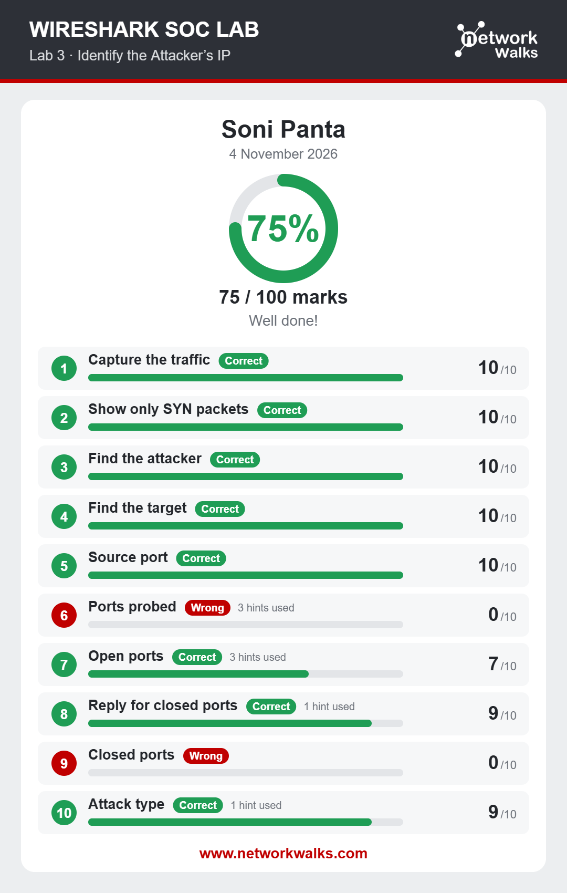
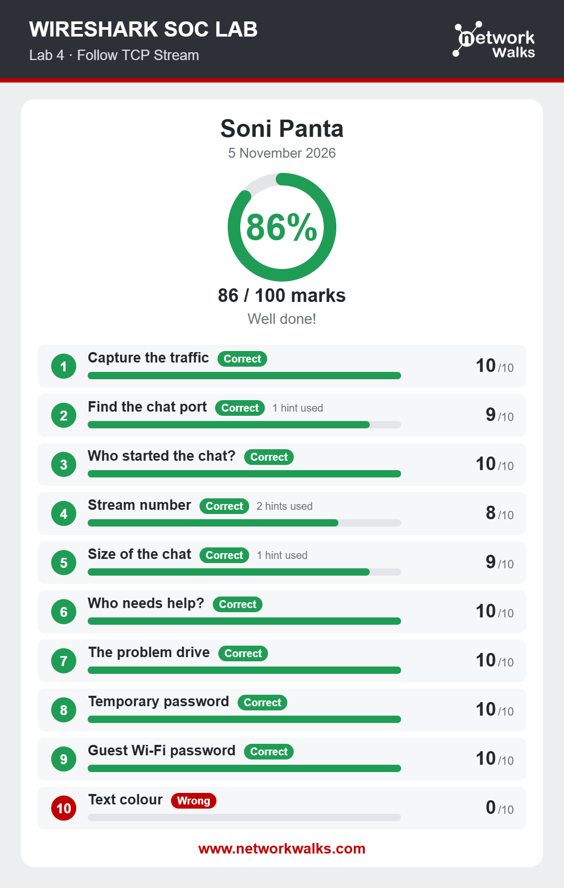
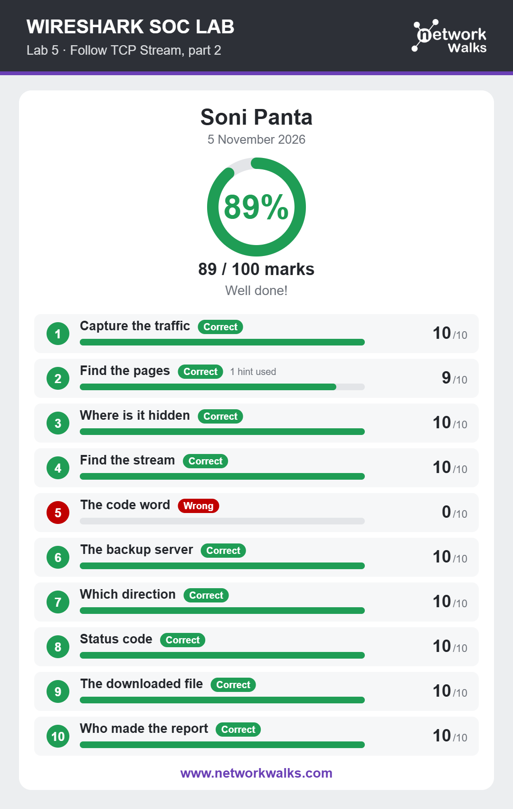
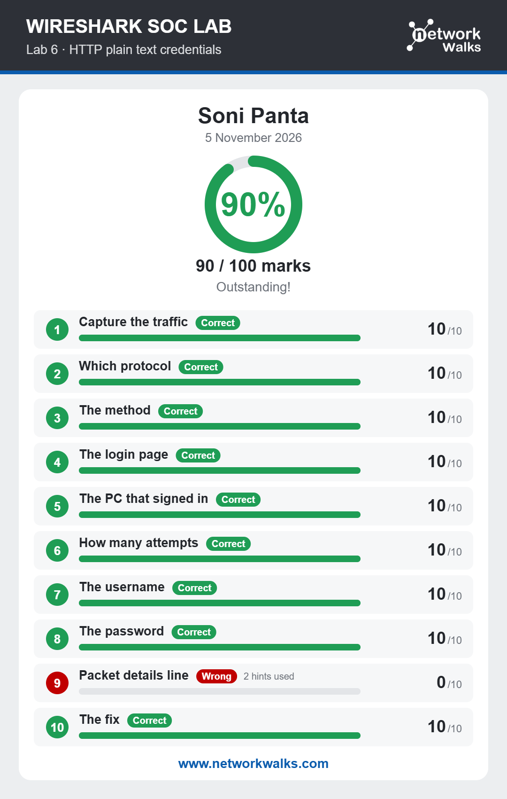
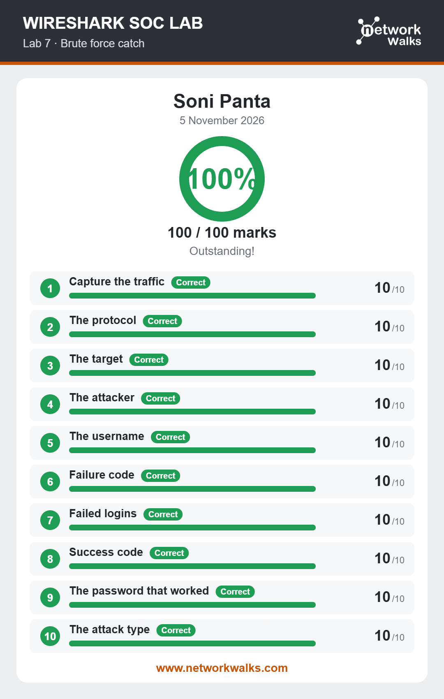
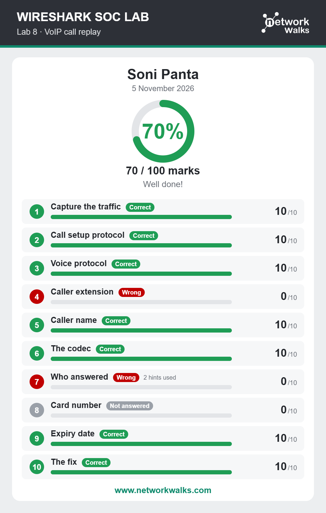

# Networkwalk-8084j-week1-cybersecurity-lab
In this lab, I have setup the virtual Box,Kali Linux and solve 6 labs using wireshark
# Kali Linux & Wireshark Labs

This repository documents my hands-on learning journey in cybersecurity, starting with Kali Linux setup and completing six practical Wireshark labs.

## 1. Kali Linux Setup

- Installed and configured Kali Linux.
- Prepared the environment for cybersecurity practicals.
- Explored basic Kali Linux tools.

## 2. Wireshark Labs

### Lab 1: Identify the Attacker's IP

**Objective:** Identify the attacker's IP address by analyzing network traffic in Wireshark.

### Lab 2: Follow TCP Stream 1

**Objective:** Analyze TCP communication using Wireshark's Follow TCP Stream feature.

### Lab 3: Follow TCP Stream 2

**Objective:** Investigate another TCP stream and understand the communication between hosts.

### Lab 4: HTTP Plain-Text Credentials

**Objective:** Analyze HTTP traffic and understand how credentials can be exposed when transmitted without encryption.

### Lab 5: Catch the Brute-Force Attacker

**Objective:** Identify suspicious repeated authentication attempts and investigate the source of the attack.

### Lab 6: Catch the Call Scammer

**Objective:** Analyze VoIP traffic using Wireshark and investigate suspicious call-related communication.

## 3. Tools Used

- Kali Linux
- Wireshark

## 4. Skills Practiced

- Network Traffic Analysis
- Packet Analysis
- TCP Stream Analysis
- HTTP Traffic Investigation
- Attacker IP Identification
- Brute-Force Attack Detection
- VoIP Traffic Analysis

## 5. Conclusion

Through these practical labs, I gained hands-on experience in network traffic analysis and learned how Wireshark can help investigate suspicious network activities as part of blue-team security operations.
